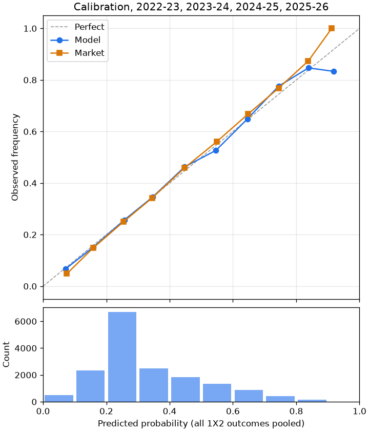
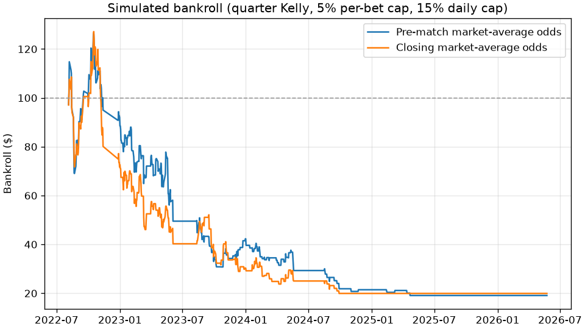

# Backtest report

Model `dc-elo-sot-0.2.0`. Test seasons: 2022-23, 2023-24, 2024-25, 2025-26. Validation seasons: 2020-21, 2021-22. Dixon-Coles / Elo blend weight chosen on the validation seasons only: **0.50 Dixon-Coles / 0.50 Elo**.

Walk-forward: models are refitted per league at the start of every month on matches dated before that month. Elo ratings are pre-match. Generated by `python -m betadvisor backtest`.

## Model comparison

Second-stage candidates read the blend's out-of-sample probabilities plus each team's shots on target for and against (exponentially weighted, decay 0.9, pre-match only). Both are refitted every month on earlier walk-forward rows. The candidate with the lower validation log loss is chosen; it replaces the blend only if its test log loss is lower too.

| Forecast | Version | Validation log loss | Test log loss | Test Brier | Flat-stake ROI (95% CI) |
|---|---|---|---|---|---|
| Dixon-Coles + Elo blend | dc-elo-0.1.0 | 1.0044 | 0.9859 | 0.5874 | -11.2% (-16.2% to -5.6%), 2931 bets |
| Blend + shots on target, logistic stacker | dc-elo-sot-0.2.0 | 1.0023 | 0.9810 | 0.5842 | -10.8% (-16.6% to -4.8%), 2674 bets |
| Gradient boosting, Platt-calibrated | gb-cal-0.2.0 | 1.0057 | 0.9852 | 0.5868 | -9.7% (-15.0% to -4.6%), 3193 bets |
| Market, de-vigged average odds | n/a | 0.9859 | 0.9688 | 0.5758 | n/a |

Chosen on validation: blend + shots on target, logistic stacker. Its test log loss is 0.0049 lower than the blend's, so it ships as `dc-elo-sot-0.2.0`.

Not included: the availability adjustment (a rating penalty per missing key player). No historical injury data exists for the backtest and the live injury feed does not say who is a key player, so it could not be tested and is left out.

## Forecast quality (lower is better)

All test matches with market odds (n = 5562):

| Forecast | Log loss | Brier |
|---|---|---|
| Model (dc-elo-sot-0.2.0) | 0.9810 | 0.5842 |
| Dixon-Coles + Elo blend | 0.9859 | 0.5874 |
| Elo only | 0.9864 | 0.5878 |
| Market, de-vigged average odds | 0.9688 | 0.5758 |

Matches where Dixon-Coles had both teams (n = 5504):

| Forecast | Log loss | Brier |
|---|---|---|
| Dixon-Coles only | 0.9966 | 0.5920 |
| Model | 0.9822 | 0.5850 |
| Market, de-vigged average odds | 0.9700 | 0.5767 |

Matches with Pinnacle closing odds (n = 4890):

| Forecast | Log loss | Brier |
|---|---|---|
| Model | 0.9771 | 0.5816 |
| Market, de-vigged average odds | 0.9642 | 0.5727 |
| Pinnacle closing, de-vigged | 0.9618 | 0.5711 |

By league:

| League | n | Model log loss | Market log loss |
|---|---|---|---|
| BL1 | 1224 | 0.9873 | 0.9716 |
| FL1 | 1298 | 0.9909 | 0.9787 |
| PD | 1520 | 0.9738 | 0.9616 |
| PL | 1520 | 0.9747 | 0.9652 |

The model's log loss is 0.0122 worse than the market (+0.0122). The bookmaker market is hard to beat; a small gap is the expected result for a public-data model.

## Calibration

| Bin | n | Model predicted | Observed | Market predicted | Market observed |
|---|---|---|---|---|---|
| 0.0-0.1 | 508 | 0.071 | 0.067 | 0.075 | 0.048 |
| 0.1-0.2 | 2333 | 0.159 | 0.151 | 0.158 | 0.148 |
| 0.2-0.3 | 6714 | 0.257 | 0.257 | 0.255 | 0.251 |
| 0.3-0.4 | 2503 | 0.346 | 0.346 | 0.345 | 0.342 |
| 0.4-0.5 | 1848 | 0.448 | 0.463 | 0.447 | 0.459 |
| 0.5-0.6 | 1325 | 0.546 | 0.527 | 0.548 | 0.560 |
| 0.6-0.7 | 874 | 0.646 | 0.649 | 0.648 | 0.668 |
| 0.7-0.8 | 419 | 0.744 | 0.776 | 0.744 | 0.768 |
| 0.8-0.9 | 150 | 0.839 | 0.847 | 0.838 | 0.873 |
| 0.9-1.0 | 12 | 0.918 | 0.833 | 0.912 | 1.000 |

## Simulated bankroll

Real decision engine (min edge 4%, odds 1.40 to 6.00, quarter Kelly, 5% per-bet cap), plus the app rules: 15% daily exposure cap in descending edge order, $1 minimum stake. Start $100. Bets are settled the same day.

| Odds used | Bets | Staked | Profit | ROI (95% CI) | Hit rate | Max drawdown | Final | Mean CLV |
|---|---|---|---|---|---|---|---|---|
| pre match avg | 507 | $1,030.61 | $-80.92 | -7.9% (-19.8% to +3.6%) | 37.7% | 84.9% | $19.08 | +0.2% |
| closing avg | 492 | $995.70 | $-80.08 | -8.0% (-20.4% to +4.5%) | 37.8% | 84.3% | $19.92 | n/a |

The ROI interval is a bootstrap over bets (fixed seed 20261109). The closing-odds run is for comparison only: those prices are known just before kickoff, after the daily run. CLV compares the pre-match price taken with the market-average closing price (negative means the price moved against the bet). Stakes are a fraction of the current bankroll, so once it shrinks many stakes fall under the $1 minimum and are skipped.

### Every signal at a flat stake

Each recommended signal at 1 unit on pre-match average odds, with no bankroll, caps or minimum stake: **2674 bets, ROI -10.8% (95% CI -16.6% to -4.8%)**.

| Season | Bets | ROI |
|---|---|---|
| 2022-23 | 716 | -4.9% |
| 2023-24 | 700 | -19.8% |
| 2024-25 | 702 | -6.4% |
| 2025-26 | 556 | -12.5% |

The whole interval is below zero: at this model version the signals lose money, and the chance that this is bad luck is small. The edges found against the market are mostly model error. Treat recommendations as paper bets only.

## Coverage

- Test matches predicted: 5562; scored against the market: 5562.
- Matches with a side unknown to Dixon-Coles (promoted club, first month), Elo used alone: 58.
- Validation matches used for the blend weight and the candidate choice: 2892.
- Second stage trained on walk-forward rows from 2014-15, 2015-16, 2016-17, 2017-18, 2018-19, 2019-20 onward; test matches without shot rates or a month without enough training rows, blend kept: 11.
- Bankroll pre match avg: skipped for the daily cap 49, under the minimum stake 2118, no odds 0.
- Bankroll closing avg: skipped for the daily cap 62, under the minimum stake 2479, no odds 0.
